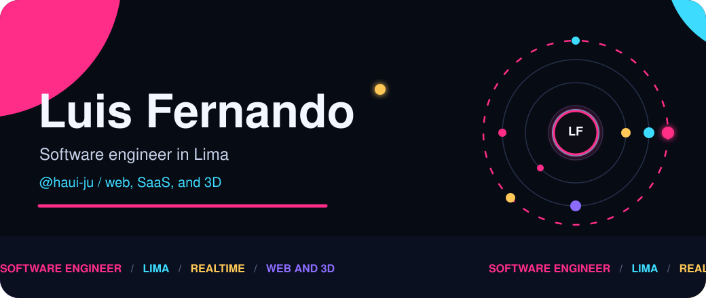
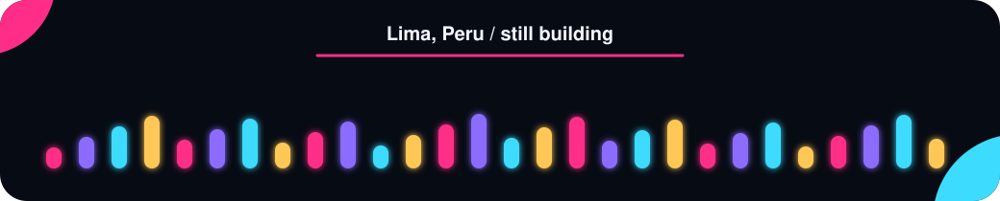

  

  

  
  
  
  
  

I study **Systems and Computer Engineering**, and I already ship: interfaces, APIs, and the deploy around them. The new layer is agents. **Cursor**, **Claude**, and **Gemini** stay open while I wire **Python**, **LangChain**, **LangGraph**, and **ChromaDB**. **Jest** watches what can break. **Power BI** is the dashboard skill I am learning for real, not as a sticker.

## Now

| Agents | Product | Proof |
| --- | --- | --- |
| LangGraph flows, retrieval with Chroma, Python services meant to run | React, Next.js, NestJS, Prisma, PostgreSQL | Jest around the fragile parts, and a slower pass on Power BI |

## Stack

  

  

  

  
  
  
  
  
  
  

## Selected work

| | | |
| --- | --- | --- |
| **[smartLove](https://github.com/haui-ju/smartLove)** Luxury hotel: LED rooms, sensors, rooftop, bar. Atmosphere in the brief, software in the repo. | **[life-stream](https://github.com/haui-ju/life-stream)** Blood-donor management. Who can give, when, and a flow that stays traceable. | **[nuuk](https://github.com/haui-ju/nuuk)** A small web piece with a [live demo](https://luis-fernando-mp.github.io/nuuk/). |

The rest lives in [the repositories](https://github.com/haui-ju?tab=repositories).

## GitHub

  
  

  

  

  

